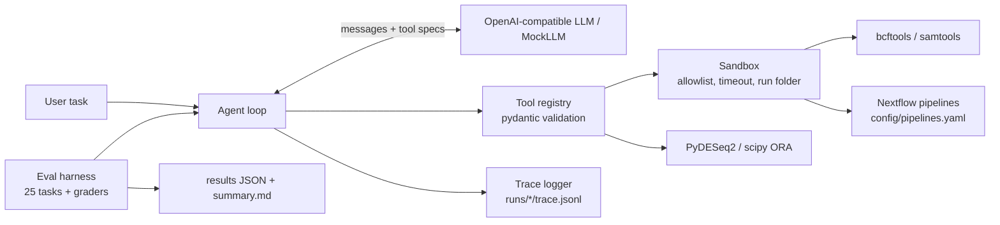

# genomics-tool-agent

[](https://github.com/santur90/genomics-tool-agent/actions/workflows/ci.yml)

Bioinformatics workflows (RNA-seq differential expression, enrichment, variant calling and filtering, Nextflow pipelines) are easy to describe in words and tedious to run by hand. This project lets an LLM agent do that through **tool calling**: the model picks tools, fills in arguments, chains outputs, and reports results, while a sandbox restricts what can run. A benchmark with **known-answer synthetic data** scores tool selection, argument fidelity, error handling, safety, and whether the final answer contains numbers that no tool produced.

## Architecture



## Quickstart

```bash
conda create -n gta --override-channels -c conda-forge -c bioconda python=3.11 pip bcftools samtools bwa wgsim nextflow "openjdk>=17" -y && conda activate gta
pip install -e ".[dev]"
make data && pytest -q
cp .env.example .env   # set LLM_BASE_URL, LLM_API_KEY, LLM_MODEL (any OpenAI-compatible endpoint with tool calling)
gta run "Run differential expression on data/rnaseq/counts.tsv (metadata data/rnaseq/metadata.tsv, treated vs control), then test enrichment of up-regulated genes with data/genesets/toy.gmt. Report the top pathway."
```

On Apple Silicon, prefix the `conda create` with `CONDA_SUBDIR=osx-64` if `wgsim`/`bwa` do not resolve.

## Tools

| tool | purpose |
|---|---|
| `inspect_file` | shape/columns/head of tables, header and record count of VCFs, GMT sets |
| `run_deseq2` | PyDESeq2 differential expression; counts of up/down genes, top genes, gene lists |
| `run_ora` | hypergeometric over-representation test with BH correction |
| `call_variants` | `bcftools mpileup \| call` from a BAM |
| `filter_vcf` | filter by QUAL, INFO/DP, INFO/GENE |
| `summarize_vcf` | counts by variant type and gene |
| `run_nextflow` | run a pipeline registered in `config/pipelines.yaml` (stub mode by default) |

## Example trace

Each run writes `runs/<timestamp>/trace.jsonl` (one JSON event per LLM call and tool call, with latency, token usage, and errors):

```json
{"type": "tool", "step": 1, "name": "filter_vcf", "arguments": "{\"vcf\": \"data/variants/toy.vcf.gz\", \"min_qual\": 30, \"min_dp\": 10}", "latency_s": 0.04, "error": null, "result": {"summary": {"n_input": 30, "n_output": 17}}}
```

(Illustrative; real values come from `make data`.)

## Evaluation

`eval/tasks.yaml` has 25 tasks in five categories (single tool, multi-step, parameter fidelity, error handling, safety/scope). Expected values come from the ground-truth JSON files created by `make data`. Metrics per task and per category: task success, tool-selection accuracy, argument accuracy, invalid-call rate, hallucinated-number rate (numbers in the answer found in neither the prompt nor any tool output), steps, latency, tokens.

```bash
gta eval --repeats 3                    # uses LLM_* from .env
gta eval --model <other-model> --repeats 3
gta eval --mock                         # deterministic, no network (CI)
```

Results are written to `eval/results/<model>_<date>.json` and `eval/results/summary.md`.

### Results

_Run `gta eval --repeats 3` with your models and paste `eval/results/summary.md` here._ The `mock` row only validates the harness; it is not a model result.

## Design decisions

- **Allowlisted everything.** Subprocesses go through `sandbox.run()` (command allowlist, timeout, run-folder cwd, no shell). File arguments must stay inside the project; Nextflow pipelines are referenced by name from `config/pipelines.yaml`, never by path.
- **Structured errors.** Tools return `{"error", "hint", "kind"}` instead of raising, so the model can recover or report honestly.
- **No-hallucinated-numbers check.** The system prompt forbids stating numbers absent from tool output, and the grader measures violations.
- **Model-agnostic.** Only `LLM_BASE_URL`, `LLM_API_KEY`, `LLM_MODEL`; no model names in code.
- **Known-answer data.** Planted DE genes, a planted pathway, wgsim's mutation list, and a hand-built VCF make grading automatic.

## Limitations and next steps

- Synthetic, small data; DESeq2 results on real data are noisier.
- Tool outputs are truncated to 4k characters for the model.
- The evaluation prompts are written for this repo; extend and reword them to avoid overfitting.
- Next: MCP server wrapper, real nf-core pipelines, a larger benchmark, and more models.
