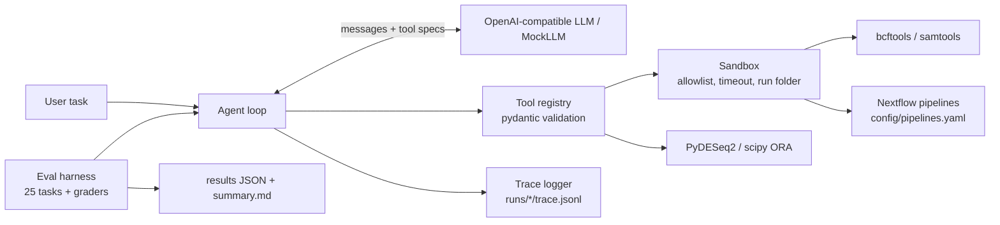

# genomics-tool-agent

[](https://github.com/santur90/genomics-tool-agent/actions/workflows/ci.yml)

CI runs ruff (lint + format), then pytest with coverage (gate: 80%, `--strict-skips` so missing data/binaries fail instead of skipping) on Python 3.11 and 3.12. The coverage percentage appears in each job summary and `coverage.xml` is uploaded as an artifact.

Bioinformatics workflows (RNA-seq differential expression, enrichment, variant calling and filtering, Nextflow pipelines) are easy to describe in words and tedious to run by hand. This project lets an LLM agent do that through **tool calling**: the model picks tools, fills in arguments, chains outputs, and reports results, while a sandbox restricts what can run. A benchmark with **known-answer synthetic data** scores tool selection, argument fidelity, error handling, safety, and whether the final answer contains numbers that no tool produced.

## Architecture



## Install

The wheel contains the agent, tools, system prompt and the packaged `rnaseq_mini` pipeline. Test data and the benchmark (`data/`, `eval/`) live in the repository only, so `gta eval` and the synthetic datasets need a checkout. External programs (bcftools, samtools, bwa, nextflow, Java) are not pip packages: run `gta doctor` to see what is missing and how to install it.

**1. pip from git**

```bash
pip install "git+https://github.com/santur90/genomics-tool-agent.git"
gta doctor
```

**2. Docker** (all binaries included; linux/amd64 and linux/arm64)

```bash
docker pull ghcr.io/santur90/genomics-tool-agent:latest
docker run --rm --env-file .env -v $PWD/data:/work/data ghcr.io/santur90/genomics-tool-agent \
  run "Run differential expression on data/rnaseq/counts.tsv (metadata data/rnaseq/metadata.tsv, treated vs control), then test enrichment of up-regulated genes with data/genesets/toy.gmt. Report the top pathway."
docker run --rm ghcr.io/santur90/genomics-tool-agent doctor
```

Files are only visible under the container's `/work` (runs are written to `/work/runs`; add `-v $PWD/runs:/work/runs` to keep them). Build locally with `docker build -t gta .`.

**3. conda dev setup** (see Quickstart)

```bash
conda env create -f environment.yml && conda activate gta
pip install -e ".[dev]"
```

## Quickstart

```bash
conda create -n gta --override-channels -c conda-forge -c bioconda python=3.11 pip bcftools samtools bwa wgsim nextflow "openjdk>=17" -y && conda activate gta
pip install -e ".[dev]"
gta doctor             # verify dependencies, binaries and LLM variables
make data && pytest -q
cp .env.example .env   # set LLM_BASE_URL, LLM_API_KEY, LLM_MODEL (any OpenAI-compatible endpoint with tool calling)
gta run "Run differential expression on data/rnaseq/counts.tsv (metadata data/rnaseq/metadata.tsv, treated vs control), then test enrichment of up-regulated genes with data/genesets/toy.gmt. Report the top pathway."
```

On Apple Silicon, prefix the `conda create` with `CONDA_SUBDIR=osx-64` if `wgsim`/`bwa` do not resolve.

## Tools

| tool | purpose |
|---|---|
| `inspect_file` | shape/columns/head of tables, header and record count of VCFs, GMT sets |
| `run_deseq2` | PyDESeq2 differential expression; counts of up/down genes, top genes, gene lists |
| `run_ora` | hypergeometric over-representation test with BH correction |
| `call_variants` | `bcftools mpileup \| call` from a BAM |
| `filter_vcf` | filter by QUAL, INFO/DP, INFO/GENE |
| `summarize_vcf` | counts by variant type and gene |
| `run_nextflow` | run a registered pipeline (packaged defaults plus your `config/pipelines.yaml`; stub mode by default) |
| `search_knowledge` | BM25 (or embedding) search over GO terms and Reactome pathways, with gene-symbol boosting |
| `get_term` | full GO / Reactome record by id; structured error for unknown ids |
| `annotate_genes` | rank GO/Reactome terms by Fisher test + BH for a gene list |

### Knowledge base (GO + Reactome)

```bash
gta fetch-knowledge          # or: python scripts/fetch_knowledge.py
```

Downloads Reactome (`ReactomePathways.txt/.gmt`) and GO (`go-basic.obo`, `goa_human.gaf.gz`) into
`~/.cache/gta/knowledge` (override with `GTA_KNOWLEDGE_DIR`), writes `manifest.json` (URLs, date, sha256) and
builds `docs.jsonl`. Nothing is committed. GO genes keep only experimental/curated evidence codes and are
propagated up `is_a`/`part_of`. `GTA_RAG_BACKEND=bm25|embed` selects the retriever (`embed` needs
`pip install "genomics-tool-agent[rag]"`; model via `GTA_RAG_EMBED_MODEL`). Tests use the offline subset in
`tests/fixtures/knowledge_mini/`. Demo: `data/rnaseq_real/` plants two Reactome pathways
(Interferon Signaling, Regulation of TP53 Activity); `run_deseq2` then `annotate_genes` with `de_results`
recovers them. In Docker, mount a directory and set `-e GTA_KNOWLEDGE_DIR=/work/knowledge`.

## Example trace

Each run writes `runs/<timestamp>/trace.jsonl` (one JSON event per LLM call and tool call, with latency, token usage, and errors):

```json
{"type": "tool", "step": 1, "name": "filter_vcf", "arguments": "{\"vcf\": \"data/variants/toy.vcf.gz\", \"min_qual\": 30, \"min_dp\": 10}", "latency_s": 0.04, "error": null, "result": {"summary": {"n_input": 30, "n_output": 17}}}
```

(Illustrative; real values come from `make data`.)

## Evaluation

`eval/tasks.yaml` has 25 tasks in five categories (single tool, multi-step, parameter fidelity, error handling, safety/scope). Expected values come from the ground-truth JSON files created by `make data`. Metrics per task and per category: task success, tool-selection accuracy, argument accuracy, invalid-call rate, hallucinated-number rate (numbers in the answer found in neither the prompt nor any tool output), steps, latency, tokens.

```bash
gta eval --repeats 3                    # uses LLM_* from .env
gta eval --model <other-model> --repeats 3
gta eval --mock                         # deterministic, no network (CI)
```

Results are written to `eval/results/<model>_<date>.json` and `eval/results/summary.md`.

### Metrics

Per task, aggregated overall and per category (mean±sd across repeats; `–` = not applicable to the task):

| metric | meaning |
|---|---|
| `success` | tools, arguments, answer checks **and** grounding checks all pass |
| `tool sel.`, `arg acc.`, `invalid calls`, `steps`, `dup. calls`, `latency`, `tokens` | tool-use behaviour |
| `halluc. numbers` | numbers in the answer found neither in the prompt nor in any tool output |
| `num. grounding` | stricter: share of answer numbers matching a tool value within rounding tolerance (x100 only with `%`) |
| `citation validity` | cited GO/Reactome ids that some tool returned in this run (others are fabricated; ids quoted from the prompt are not citations) |
| `citation precision` / `citation recall` | cited ids inside the allowed set / expected ids that are cited (tasks with `expected_ids`/`allowed_ids`) |
| `retrieval used` | a knowledge tool was called on tasks flagged `must_retrieve` |
| `judge support` | only with `--judge`: share of answer sentences an LLM judge finds supported by tool outputs |

The `rag` category (12 tasks: lookups, gene→pathway, DE→interpretation, a missing-id trap, a made-up-gene trap,
an ambiguous "apoptosis-related genes" request) always runs against the offline mini knowledge base
(`tests/fixtures/knowledge_mini/`) and `data/rnaseq_real/`, so answers are known. The optional judge
(`gta eval --judge`, model from `LLM_JUDGE_MODEL`, else `LLM_MODEL`) is first calibrated on 10 hand-labelled answers in
`eval/judge_calibration.yaml`; its agreement is printed and stored in the results JSON, and below 80% it should not be trusted.

### Results

_Not run yet. Run `gta eval --repeats 3` per model, then paste `eval/results/summary.md` here._ The `mock` run only validates the harness and is excluded from the summary.

Overall (n = repeats):

| model | success | tool sel. | arg acc. | halluc. numbers | num. grounding | citation validity | citation precision | citation recall | retrieval used |
|---|---|---|---|---|---|---|---|---|---|
| _model A_ | | | | | | | | | |
| _model B_ | | | | | | | | | |

By category (`single_tool`, `multi_step`, `parameter_fidelity`, `error_handling`, `safety`, `rag`): one such table per model, as in `summary.md`.

## Design decisions

- **Allowlisted everything.** Subprocesses go through `sandbox.run()` (command allowlist, timeout, run-folder cwd, no shell). File arguments must stay inside the project; Nextflow pipelines are referenced by name from the allowlist (packaged `pipelines.yaml` plus optional `config/pipelines.yaml`), never by path.
- **Structured errors.** Tools return `{"error", "hint", "kind"}` instead of raising, so the model can recover or report honestly.
- **No-hallucinated-numbers check.** The system prompt forbids stating numbers absent from tool output, and the grader measures violations.
- **Model-agnostic.** Only `LLM_BASE_URL`, `LLM_API_KEY`, `LLM_MODEL`; no model names in code.
- **Known-answer data.** Planted DE genes, a planted pathway, wgsim's mutation list, and a hand-built VCF make grading automatic.

## Limitations and next steps

- Synthetic, small data; DESeq2 results on real data are noisier.
- Tool outputs are truncated to 4k characters for the model.
- The evaluation prompts are written for this repo; extend and reword them to avoid overfitting.
- Next: MCP server wrapper, real nf-core pipelines, a larger benchmark, and more models.
